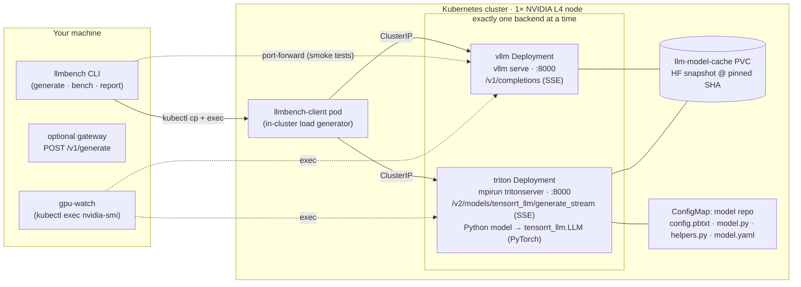

# vLLM vs. Triton + TensorRT-LLM on Kubernetes (single GPU)

A reproducible, apples-to-apples comparison of two LLM serving stacks on **one NVIDIA GPU in Kubernetes**:

- **vLLM** v0.30.0 via its OpenAI-compatible server.
- **NVIDIA Triton Inference Server** 26.07 + **TensorRT-LLM 1.2.1**, using NVIDIA's recommended **LLM API (PyTorch backend)**. There's no legacy `trtllm-build` engine step.

Both serve the same model (`Qwen/Qwen2.5-1.5B-Instruct`, pinned commit) with the same prompts, sampling, KV-cache budget and concurrency levels, one after the other on the same GPU.

> **Benchmark status: PENDING.** Everything here was built and tested without a GPU (see
> [docs/VERIFICATION.md](docs/VERIFICATION.md)). No performance numbers exist yet, and none are shown anywhere in this repo.
> [Benchmark](#5-benchmark) gives the exact commands to produce them.

| | |
|---|---|
| Plan & version research | [docs/PLAN.md](docs/PLAN.md) |
| Reproduce one request (tutorial) | [docs/TUTORIAL.md](docs/TUTORIAL.md) |
| Findings & comparability notes | [docs/FINDINGS.md](docs/FINDINGS.md) |
| 3–5 minute demo script | [docs/DEMO_SCRIPT.md](docs/DEMO_SCRIPT.md) |
| What was / wasn't verified | [docs/VERIFICATION.md](docs/VERIFICATION.md) |

## Architecture



- **One request format.** `llmbench.schema.GenerationRequest` describes the request once, and each backend client maps it to its native API. Every result carries `backend` (the gateway also sets the `X-LLM-Backend` header).
- **One engine config.** The Helm chart's `engine:` block (max sequences, max length, KV-cache bytes, prefix caching, CUDA graphs, …) is rendered into vLLM flags *and* TRT-LLM's `model.yaml`. A test asserts they stay equal.
- **Raw data first.** The load generator writes one JSON line per request. Every reported metric is recomputed from those lines by `llmbench report`.

## Repository layout

```
configs/benchmark.yaml          experiment definition (sampling, concurrency, request counts)
configs/prompts.jsonl           24 fixed prompts, pre-templated (generated by scripts/build_prompts.py)
deploy/helm/llm-serving/        Helm chart: backend=vllm|triton, values.schema.json validation
  files/triton/                 NVIDIA's LLM-API Triton model files @ TRT-LLM v1.2.1 + 3-line patch
llmbench/                       Python package: clients, load generator, metrics, report, gateway, fake server
scripts/                        prepare cache · run one backend · run full comparison · teardown · vendoring
tests/                          93 GPU-free tests (client, config, metrics, Helm rendering, pipeline)
results/ reports/               raw benchmark output / generated reports (empty until a GPU run)
```

## Pinned versions

| Component | Version | Notes |
|---|---|---|
| vLLM image | `vllm/vllm-openai:v0.30.0@sha256:8a69ffad…4b90` | CUDA 13.0 build |
| Triton image | `nvcr.io/nvidia/tritonserver:26.07-trtllm-python-py3@sha256:b097871d…7007` | Triton 2.71.0, TensorRT-LLM 1.2.1 (newest Triton image that ships TRT-LLM; 26.08/26.09 don't) |
| Triton model files | TensorRT-LLM `v1.2.1` (`376f7e1b`) `triton_backend/all_models/llmapi` | vendored + patch, see [UPSTREAM.md](deploy/helm/llm-serving/files/triton/UPSTREAM.md) |
| Model | `Qwen/Qwen2.5-1.5B-Instruct` @ `989aa7980e4cf806f80c7fef2b1adb7bc71aa306` | Apache-2.0, not gated, BF16, 3.09 GB |
| Client pod | `python:3.12.12-slim@sha256:f3fa41d7…b7c` | in-cluster load generator |
| Kubernetes | ≥ 1.29 (validated against v1.35 API server, kubectl 1.37, Helm 4.3) | |
| GPU stack | NVIDIA GPU Operator v26.7.1 / device plugin v0.20.1; driver **R580+** (CUDA 13) | |

Why this model and GPU: see [docs/PLAN.md](docs/PLAN.md#model-choice). In short, it's openly downloadable, both stacks list its architecture as supported, and it fits a single 24 GB **NVIDIA L4** with lots of KV-cache room. TRT-LLM 1.2.1 supports Ampere or newer, so a T4 won't work.

## 1. Prerequisites

- A Kubernetes cluster with **one NVIDIA GPU node** (L4 24 GB recommended; A10G/RTX 30–40 series also work) exposing `nvidia.com/gpu`. Install the NVIDIA GPU Operator or use your cloud's managed GPU drivers. The node driver must support CUDA 13 (R580+).
- A default StorageClass (for the 20 Gi model-cache PVC).
- Cluster egress to Docker Hub, nvcr.io, Hugging Face and PyPI. The client pod `pip install`s `httpx` and `pyyaml`.
- Locally: `kubectl`, `helm` ≥ 3.8, Python ≥ 3.10.

<details>
<summary>Example: a GKE cluster with one L4 node (<b>creates billable resources — not run by the author</b>)</summary>

```bash
gcloud container clusters create llm-bench --zone us-central1-a \
  --num-nodes 1 --machine-type e2-standard-4 --release-channel regular
gcloud container node-pools create l4 --cluster llm-bench --zone us-central1-a \
  --machine-type g2-standard-8 --num-nodes 1 \
  --accelerator type=nvidia-l4,count=1,gpu-driver-version=latest
kubectl get nodes -L cloud.google.com/gke-accelerator   # one node should show nvidia-l4
```
Check current pricing for your region first. Expect roughly 1.5–2 GPU-hours for setup, image pulls, both runs and one re-run (an estimate, not a measurement). Delete the cluster afterwards (see [Teardown](#7-teardown)).
</details>

<details>
<summary>Any other cluster: install the GPU Operator</summary>

```bash
helm repo add nvidia https://helm.ngc.nvidia.com/nvidia && helm repo update
helm install gpu-operator nvidia/gpu-operator -n gpu-operator --create-namespace --version v26.7.1
kubectl get nodes -o custom-columns=NAME:.metadata.name,GPU:.status.allocatable.nvidia\\.com/gpu
```
</details>

## 2. Local setup

```bash
python3 -m venv .venv && source .venv/bin/activate
pip install -e ".[dev]"
pytest -q                       # 93 tests, no GPU needed (Helm tests skip if helm is absent)
llmbench validate-config        # shows the per-level request plan
```

## 3. Deploy

```bash
export NAMESPACE=llm
scripts/prepare_model_cache.sh          # PVC + one-shot download Job at the pinned revision
helm install vllm deploy/helm/llm-serving -n llm -f deploy/helm/llm-serving/values-vllm.yaml
kubectl -n llm rollout status deploy/vllm --timeout=45m
```

For Triton, uninstall vLLM first (one GPU), then:

```bash
helm uninstall vllm -n llm
helm install triton deploy/helm/llm-serving -n llm -f deploy/helm/llm-serving/values-triton.yaml
kubectl -n llm rollout status deploy/triton --timeout=45m
```

What the chart sets up:

| Concern | How |
|---|---|
| GPU | `requests/limits: nvidia.com/gpu: 1`, toleration for `nvidia.com/gpu`, `strategy: Recreate` (a rolling update would wait forever for a 2nd GPU) |
| Health | `startupProbe` (up to 15 min for load + CUDA-graph capture), readiness, liveness. vLLM: `/health`. Triton: `/v2/models/tensorrt_llm/ready` and `/v2/health/live` |
| Config | vLLM: CLI flags from `engine:`. Triton: a ConfigMap model repo, copied into an emptyDir by an init container (ConfigMap volumes contain `..data` symlinks that Triton would scan as models) |
| Resources | CPU 4/8, memory 16Gi/24Gi (request/limit), `/dev/shm` 4Gi (memory-backed) |
| Exposure | `ClusterIP` only. Use `kubectl port-forward`; never expose an unauthenticated LLM endpoint publicly |
| Credentials | None needed (ungated model). For gated models: `kubectl create secret generic hf-token --from-literal=token=…` and `--set hfToken.secretName=hf-token`. Nothing secret lives in the repo |
| Reproducibility | images pinned by digest; model by commit SHA; `HF_HUB_OFFLINE=1` so both backends load the same cached bytes |
| Validation | `values.schema.json` rejects unknown backends, non-SHA revisions, `nvidia.com/gpu ≠ 1`, unknown `engine` keys |

Smoke request (details in the [tutorial](docs/TUTORIAL.md)):

```bash
kubectl -n llm port-forward svc/vllm 8000:8000 &
llmbench generate --backend vllm --url http://localhost:8000 "What is a KV cache?"
```

## 4. The client and gateway

```bash
llmbench generate --backend {vllm|triton} --url URL "prompt"   # one request → JSON incl. "backend", ttft_s, e2e_s
llmbench health   --backend triton --url URL
llmbench info     --backend triton --url URL                    # server version; verifies the ignore_eos patch is loaded
LLMBENCH_VLLM_URL=http://localhost:8000 llmbench gateway --port 9000
curl -s localhost:9000/v1/generate -d '{"prompt":"hi","backend":"vllm"}' -H 'content-type: application/json' -i
```

The gateway is a thin FastAPI service (`pip install '.[gateway]'`) that accepts one request schema for both backends and returns `X-LLM-Backend`. It is a convenience for demos, not part of the benchmark path.

## 5. Benchmark

Full sequential comparison: cache → vLLM → uninstall → Triton → uninstall → report.

```bash
NAMESPACE=llm scripts/run_comparison.sh results/2026-10-l4
```

Or one backend at a time:

```bash
scripts/run_benchmark.sh vllm   results/2026-10-l4
scripts/run_benchmark.sh triton results/2026-10-l4
llmbench report results/2026-10-l4 --out reports/2026-10-l4
```

| Setting (from `configs/benchmark.yaml`) | Value |
|---|---|
| Prompts | 24 fixed prompts, 37–302 input tokens (mean 128.5), interleaved short/medium/long |
| Output | exactly 256 tokens (`max_tokens: 256` + `ignore_eos: true`) |
| Decoding | greedy, seed 0 |
| Concurrency | 1, 4, 16, 32, 64 closed-loop workers |
| Requests per level | measured `max(64, 4×C)`, warm-up `max(4, C)` (excluded from metrics) |
| Client | `CLIENT=incluster` (default): pod → ClusterIP. `CLIENT=local`: through `port-forward` |

**What gets recorded** in `results/<run>/<backend>/`:

| File | Contents |
|---|---|
| `requests.jsonl` | One line per request: phase, concurrency, prompt id, TTFT, E2E, tokens + their source, finish reason, errors, generated text |
| `gpu.jsonl` | `nvidia-smi` memory/utilization every second |
| `meta.json` | Config, prompts SHA-256, server version info, GPU name/driver, argv, timestamps, Helm values, pod image digests, node labels |
| `k8s/` | Rendered manifest, `helm-values.json`, `pod.json`, `node-summary.json`, `nvidia-smi.txt`, `server.log`, `commands.log` |

**Metrics** (definitions in [`llmbench/metrics.py`](llmbench/metrics.py)):

| Metric | Definition |
|---|---|
| TTFT | Time from send to first non-empty text chunk |
| Output tok/s | Sum of output tokens ÷ measured window |
| E2E p50/p95 | Send to stream close, per request |
| Request throughput | Successful requests ÷ window |
| TPOT | (E2E − TTFT)/(tokens − 1) |
| Failures | HTTP errors, in-stream errors and empty outputs, all counted |
| GPU memory | Peak and mean utilization during each measured window |

The report also flags any request that did not produce exactly `max_tokens` tokens. It compares greedy outputs between backends as a sanity check on sampling parity.

## 6. Report

`llmbench report` writes `summary.csv`, `summary.json`, `summary.md` (side-by-side tables with Triton-vs-vLLM % change and automatic caveats) and `comparison.png`. With no measured results it writes an explicit **PENDING** report. It never invents values. Reports built from the fake test server are stamped **SYNTHETIC**.

## 7. Teardown

```bash
scripts/teardown.sh               # uninstall releases, delete cache Job, PVC and namespace
scripts/teardown.sh --keep-cache  # keep the downloaded weights for another run
# Stop billing: delete the GPU node pool / cluster, e.g.
gcloud container clusters delete llm-bench --zone us-central1-a
```

## 8. Troubleshooting

| Symptom | Likely cause / fix |
|---|---|
| Pod `Pending`: `Insufficient nvidia.com/gpu` | No GPU node, the device plugin isn't running, or the *other* backend still holds the GPU (`helm list -n llm`) |
| Pod `Pending`: PVC unbound | No default StorageClass. Set `modelCache.storageClassName` |
| `CUDA driver version is insufficient` | Node driver older than R580. Both images are CUDA 13 builds; upgrade the driver / GPU Operator |
| Startup probe kills the pod | First start with CUDA-graph capture can be slow. Raise `probes.startup.failureThreshold` |
| `HF_HUB_OFFLINE` / file-not-found errors | Cache not populated. Run `scripts/prepare_model_cache.sh`, or set `modelCache.offline=false` |
| Triton: `unexpected inference input 'sampling_param_ignore_eos'` | Unpatched model files. Redeploy the chart; `llmbench info --backend triton` shows `ignore_eos_supported` |
| Triton: `Streaming is only supported in decoupled mode` | `triton_config.decoupled` must stay `true` (set by the chart) |
| Triton: `ModuleNotFoundError: tensorrt_llm.bindings` | Only happens when launching from inside a TensorRT-LLM source checkout. The pod doesn't do that |
| Triton crashes with chunked prefill on your GPU | `--set engine.chunkedPrefill=false` (then note the asymmetry; vLLM V1 always chunks) |
| OOM at startup | Lower `engine.kvCacheBytes` (applies to both backends) or `engine.maxNumSeqs` |
| Throughput flat at high concurrency, `CLIENT=local` | `kubectl port-forward` is the bottleneck. Use the default `CLIENT=incluster` |
| Client pod can't `pip install` | No cluster egress to PyPI. Use `CLIENT=local`, or pre-build an image with `llmbench` |
| `nvidia-smi` missing in pod | GPU sampling is optional; results are still valid, and GPU columns show `–` |
| TRT-LLM core dump on shutdown | Known upstream issue (Triton release notes). Teardown only; inference is unaffected |

## Tests

```bash
pytest -q
```

93 tests run in about 5 s with no GPU. They cover:

- **Client behavior:** payload mapping per backend, SSE parsing, Triton's cumulative streaming, error and timeout handling, token-count fallbacks.
- **Configuration validation:** benchmark config, prompt-file integrity, Helm schema, and identical engine settings across backends.
- **Metric calculations:** checked against hand-computed values.
- **Full pipeline:** load generator → report against an in-process fake server, plus the gateway.

## License

MIT for this repository's code. Files under `deploy/helm/llm-serving/files/triton/` are NVIDIA's (Apache-2.0 TensorRT-LLM repo, original headers kept).
